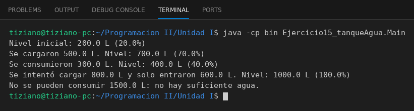

# TanqueAgua

Programación II - Unidad 1 - Ejercicio 15

## Consigna
Modelar un tanque de agua con capacidad máxima y nivel actual, controlando la carga y el consumo para evitar desbordes y faltantes.

## Lógica
- **Atributos (privados):** `capacidadMaximaLitros` y `nivelActualLitros` (double).
- **Constructor:** valida capacidad positiva y que el nivel actual esté entre 0 y la capacidad máxima.
- **`llenar(litros)`:** carga como máximo el espacio libre (`Math.min(litros, espacioLibre)`), de modo que el nivel nunca supera la capacidad; retorna los litros que realmente entraron.
- **`consumir(litros)`:** si hay suficiente agua la descuenta y retorna `true`; si no, no modifica el nivel y retorna `false`.
- **`getPorcentajeLlenado()`:** `nivel / capacidad * 100`.
- **`Main`:** tanque de 1000 L con 200 L; carga 500, consume 300, intenta cargar 800 (solo entran 600) e intenta consumir 1500 (rechazado), mostrando el porcentaje en cada paso.

## Ejecución

